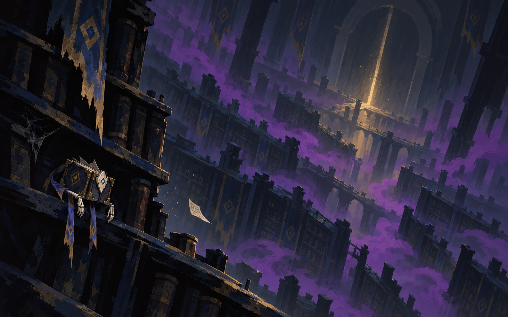
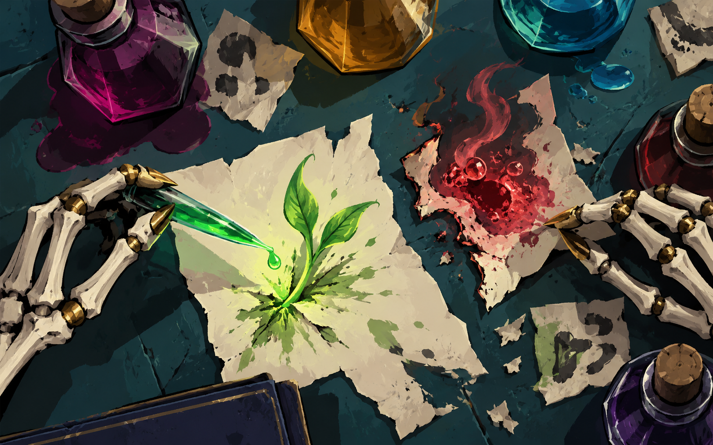

# 图书管理员 · Librarian

**V1.4.11 支持游戏 Beta 0.114.0，需要 RitsuLib 0.6.16 或更新版本。其余五个游戏版本需要 RitsuLib 0.6.13 或更新版本。**

**V1.4.11 supports game Beta 0.114.0 with RitsuLib 0.6.16 or later. The other five game versions require RitsuLib 0.6.13 or later.**

  

浮空藏书馆 · 三元素法球 · Slay the Spire 2 原创角色

V1.4.11 适配了新版游戏里的教学弹窗、解锁等弹窗的快捷键，以及烈焰击杀特效的扣血回调。

V1.4.11 updates tutorial popups, dialog shortcuts, and the Fire Orb kill effect for the new game API.

An original playable character mod for **Slay the Spire 2**: a floating magical
archive with three elemental orbs, 91 active cards, 9 relics and 3 potions.
Includes Simplified Chinese, English, Japanese, Korean, Spanish and French, language settings, and
custom translation packs.

图书管理员通过烈焰、波涛、翠叶三种法球的注魔、结算与锁定组织战斗。
本仓库用于源码维护、独立版本下载和玩家反馈。

- [V1.4.11 / 当前版本下载与公告](https://github.com/albertoBradish/Librarian-StS2/releases/tag/v1.4.11)
- [Releases / 独立下载](https://github.com/albertoBradish/Librarian-StS2/releases)
- [Published historical beta package / 已发布历史 beta 包 1.2.0-beta12](https://github.com/albertoBradish/Librarian-StS2/releases/tag/v1.2.0-beta12)。此历史版下载同一发行的三份运行文件与许可；V1.4.0 采用六文件结构。This historical release has three runtime files; V1.4.0 uses six.
- [Source and release history / 源码与发布历史](RELEASE-BATCHES.md)。历史发行状态保留；当前统一包身份另见[构建元数据](release-metadata.json)。Historical publication records remain separate from this unified source snapshot.
- [Historical release index / 历史版本与校验来源](release-history.json)
- [Migration verification / 22 个版本、352 个附件下载核验](release-history/verification.json)
- [Issues / 问题与建议](https://github.com/albertoBradish/Librarian-StS2/issues)
- [Steam Workshop](https://steamcommunity.com/sharedfiles/filedetails/?id=3801958367)
- [Build / 构建](BUILDING.md) · [Release / 发版](RELEASING.md) · [Contributing](CONTRIBUTING.md)
- [Translation packs / 翻译包](TRANSLATIONS.md)

## A story in seven chapters / 七章原创时间线

七章中英故事随现有解锁进度逐步展开，搭配七张章节插图、原生多色文字强调与少量文字动效。从旧藏书馆中的沉睡，到独自整理散卷、研究药剂，浮空书体用自己的方式记录旅程。故事属于模组原创补叙；阅读章节不增加新的解锁要求。

Seven original chapters in Simplified Chinese and English unfold through the existing unlock progression. Seven illustrations, native colored emphasis and restrained text animation accompany a floating book's journey through scattered records and practical experiments. This is original mod fiction, with no additional chapter-unlock requirements.

### Three elements, scattered scrolls / 三元素与散落书卷

烈焰、波涛、翠叶通过注魔、结算与锁定相互配合。锁定显示可选默认的红色负数回合、旧回合显示，或球心原值加下方回合；显示方式不改变法球规则。

Activate, Settle and Lock Fire, Tide and Growth Orbs. Choose red negative lock turns, the old turn counter, or the original value with turns below. These display choices leave orb rules unchanged.

### Notes, experiments and choices / 笔记、实验与选择

药剂笔记以手与器物讲述故事。显示、声音和语言设置可从主页右上角的 RitsuLib 页面进入；恢复默认设置保留解锁与游玩进度。开始提示的“确定”仅关闭本次，选择“不再显示”才停止当前版本的自动提示。

Potion notes tell their story through hands and objects. Open Librarian's display, audio and language settings from RitsuLib at the top right of the main menu. Restoring defaults preserves unlock and play progress. “OK” closes the current introduction; “Don't show again” disables automatic introductions for that version.

## Compatibility / 兼容范围

[Release metadata](release-metadata.json) lists the six supported game commits and ten runtime file hashes for V1.4.11. The loader selects the content DLL for the installed game.

| Component | Verified baseline |
| --- | --- |
| Slay the Spire 2 | 0.107.1 (59260271), 0.111.0 (41cef1ea), 0.111.1 (cc1f9462), 0.113.0 (16ac0fe3), 0.113.1 (d09d48e5), 0.114.0 (a7b9a9c0) |
| BaseLib | Only relevant to historical releases |
| [RitsuLib](https://github.com/BAKAOLC/STS2-RitsuLib) | Minimum 0.6.16 on game 0.114.0 and 0.6.13 on the other listed game versions. |

Manifest minimum versions are not a promise of compatibility with newer game
or dependency versions. Single-player is the primary supported path. Multiplayer
integration exists, but real multi-client/reconnect testing and long-term balance
validation remain incomplete. Visual/audio feedback is welcome.

## Install / 安装

1. Use one of the six game versions listed above.
2. Install and enable the complete RitsuLib bundle for your game version.
3. From the same GitHub Release, download the ten runtime files and follow `INSTALL-MAP.json`. Keep the four root files together under `mods/Librarian/`. Rename each `compat-<version>-Librarian.dll` to `Librarian.dll` under the corresponding `compat/<version>/` directory. Keep the notices and verify `SHA256SUMS.txt`.
4. For Workshop migration, subscribe to [3801958367](https://steamcommunity.com/sharedfiles/filedetails/?id=3801958367), quit the game, unsubscribe from old 3811677053, wait for the download, and restart with Librarian enabled. Keep saves. The old item remains public with a final migration notice after the new release succeeds; duplicate ModIds cannot guarantee that the new copy wins.
5. Avoid loading both Workshop and manual copies of Librarian. Exit the game
   before changing mod files, back up saves, and use a spare profile/new run when
   testing a beta. Follow the game's mod activation/restart prompts.

The automatically generated GitHub **Source code** archives are source snapshots,
not installable mod packages. Download the complete runtime attachment set for
the selected release. No full ZIP is produced by default.
Historical binary archive tags contain provenance/notices only when a matching
complete historical source tree is unavailable; they do not substitute current
source for old versions. See the per-version release notes and provenance.
Players do not need the .NET SDK or Godot editor. Workshop and GitHub are separate
distribution channels; each release states its own version and compatibility.

请勿混用不同版本的 DLL/JSON/PCK，也不要同时加载工坊与手动安装的重复副本。
卸载前退出游戏；含本角色内容的存档需要对应模组才能继续。

## Feedback / 反馈

Use an [issue template](https://github.com/albertoBradish/Librarian-StS2/issues/new/choose)
and include game branch/build, mod and dependency versions, installation channel,
other mods, reproduction steps, expected/actual behavior, and screenshots/logs
where useful. Review logs for account names, save data and tokens before posting.

## 鸣谢 / Acknowledgments

简体中文

以下致谢名单不分先后：@XLZC，@Evolto，@shuyushuyu，@Wakazu，@Emily，@Xianyu，@Optics，@冬冬，@OrangePig，@Pengonut（The Flaw角色作者），@Quanthon，@hotwords123（Random Foreseer作者），@after.story，@yyqy，@Comic Chess(女王与知识恶魔角色作者）与所有游玩过，无论给出好评还是差评的大家，还有现在也许已经订阅游玩的你

English

My thanks, in no particular order, go to @XLZC, @Evolto, @shuyushuyu, @Wakazu, @Emily, @Xianyu, @Optics, @冬冬, @OrangePig, @Pengonut (creator of the character The Flaw), @Quanthon, @hotwords123 (creator of Random Foreseer), @after.story, @yyqy, and @Comic Chess (creator of the characters The Queen and Knowledge Demon). A heartfelt thank-you to everyone who has played and to everyone who left a review, positive or negative. And thank you for reading this far. Maybe you’re already subscribed and playing!

日本語

順不同で、@XLZC、@Evolto、@shuyushuyu、@Wakazu、@Emily、@Xianyu、@Optics、@冬冬、@OrangePig、@Pengonut（キャラクター「The Flaw」の作者）、@Quanthon、@hotwords123（「Random Foreseer」の作者）、@after.story、@yyqy、@Comic Chess（キャラクター「The Queen」と「Knowledge Demon」の作者）に感謝します。遊んでくださった皆さん、好評・不評を問わずレビューを寄せてくださった皆さん、そしてここまで読んでくださったあなたにも、心から感謝しています。もしかすると、もうサブスクライブして遊んでくださっているかもしれませんね。

한국어

순서와 관계없이 @XLZC, @Evolto, @shuyushuyu, @Wakazu, @Emily, @Xianyu, @Optics, @冬冬, @OrangePig, @Pengonut(The Flaw 캐릭터 제작자), @Quanthon, @hotwords123(Random Foreseer 제작자), @after.story, @yyqy, @Comic Chess(The Queen 및 Knowledge Demon 캐릭터 제작자)에게 감사드립니다. 플레이해 주신 모든 분, 긍정적이든 부정적이든 평가를 남겨 주신 모든 분께 진심으로 감사드립니다. 그리고 지금 이 글을 읽는 분께도 감사드립니다. 어쩌면 이미 구독하고 즐겨 주고 계실지도 모르겠네요!

Español

Mi agradecimiento, sin ningún orden en particular, a @XLZC, @Evolto, @shuyushuyu, @Wakazu, @Emily, @Xianyu, @Optics, @冬冬, @OrangePig, @Pengonut (creador del personaje The Flaw), @Quanthon, @hotwords123 (creador de Random Foreseer), @after.story, @yyqy y @Comic Chess (creador de los personajes The Queen y Knowledge Demon). Gracias de corazón a quienes han jugado y a quienes se han tomado el tiempo de dejar una reseña, positiva o negativa. Y gracias a ti por leer hasta aquí. ¡Quizá ya te hayas suscrito y estés jugando!

Français

Je tiens à remercier, sans ordre particulier, @XLZC, @Evolto, @shuyushuyu, @Wakazu, @Emily, @Xianyu, @Optics, @冬冬, @OrangePig, @Pengonut (créateur du personnage The Flaw), @Quanthon, @hotwords123 (créateur de Random Foreseer), @after.story, @yyqy et @Comic Chess (créateur des personnages The Queen et Knowledge Demon). Merci du fond du cœur à toutes les personnes qui ont joué et à celles qui ont laissé un avis, positif ou négatif. Et merci à vous de m’avoir lu jusqu’ici. Peut-être êtes-vous déjà abonné au mod et en train d’y jouer !

## License / 许可证

**Source-available, not open source.** Project-owned code, setting, writing and
artwork follow the [Librarian Personal Use and Original Content License](LICENSE).
Personal study/builds are permitted; unauthorized adaptation, redistribution,
commercial use and secondary monetization are prohibited. See [original asset
scope](ASSET-LICENSE.md). Upstream MIT portions retain their own permissions:
[notices](THIRD-PARTY-NOTICES.md), [license review](LICENSE-AUDIT.md).

源码公开可读，不代表开源或可自由二创。原创设定、美术、文案等未经书面许可不得
改编、再发布、商用或二次盈利。所有许可首先服从 Mega Crit 的模组政策，作者的
授权不能豁免官方禁止的盈利行为。
This is an unofficial community mod, not affiliated with or endorsed by Mega Crit.

开发与美术制作使用了 AI 辅助，内容由作者审阅并根据玩家反馈调整。
AI tools assisted programming and artwork production. The author reviews the content and revises it with player feedback.
